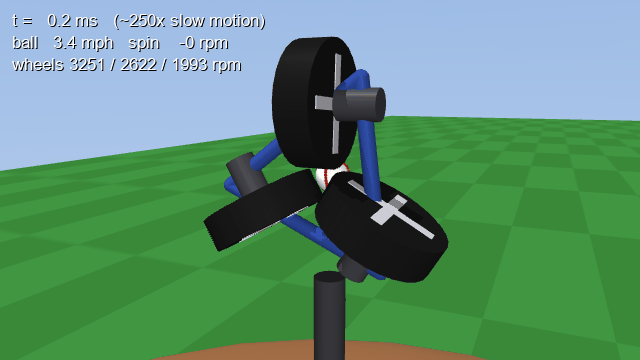
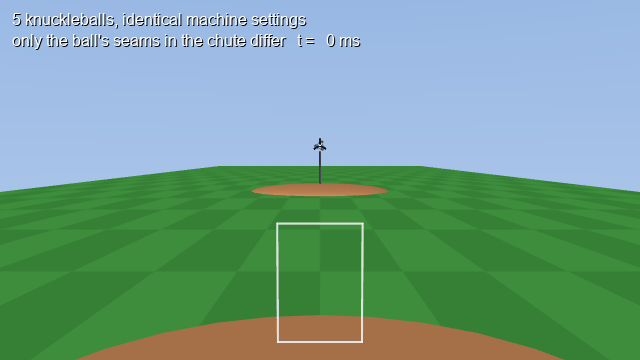
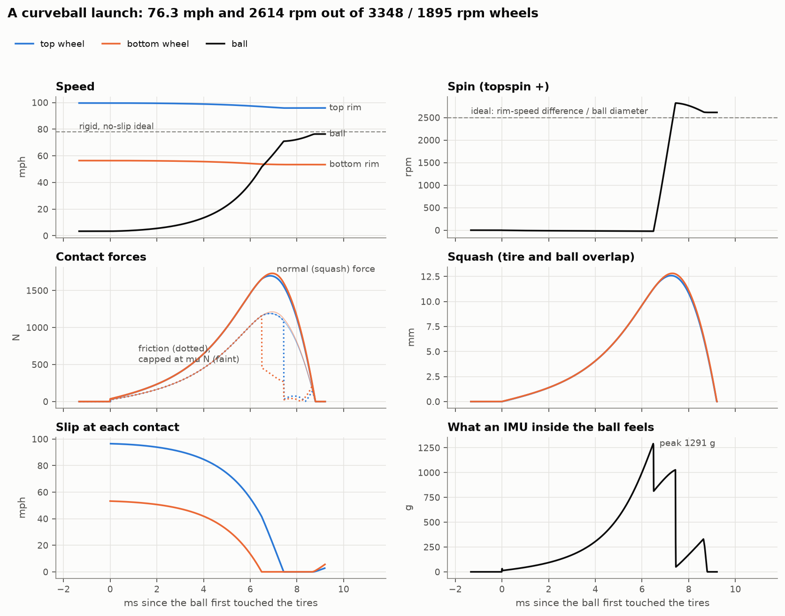
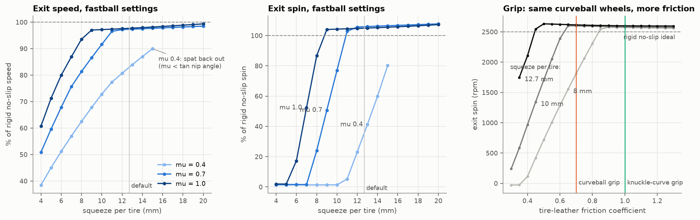
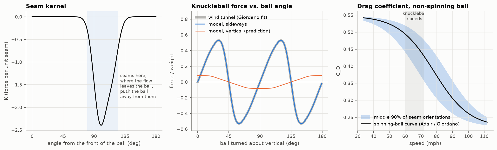
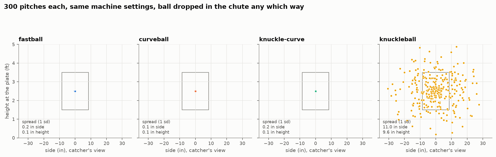
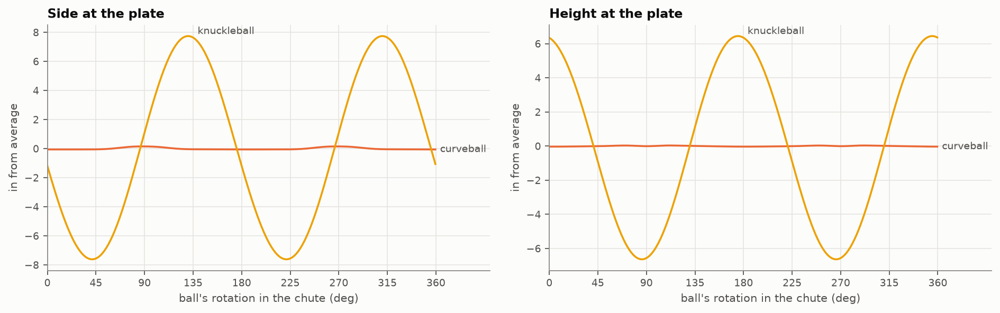
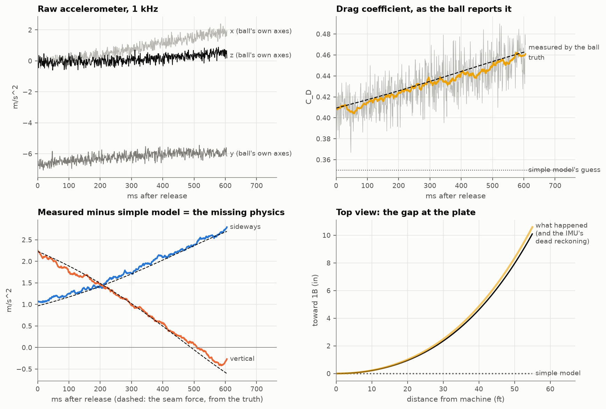

# knuckle-curve

A two-wheel pitching machine simulated from the contact patch up, in MuJoCo.

Nothing here hands the ball a spin rate. The wheels are motors with inertia,
the ball is fed into the gap between them, and whatever speed and spin it
leaves with comes out of the contact: tire and leather squash into each other,
friction can only push as hard as μ times that squash force, and the ball
slips until one tire catches it. Then the ball flies through air that cares
where its seams are.

<p align="center">
  
  
</p>
<p align="center"><sub>Left: a curveball going through the wheels at ~250x slow motion. Right: five knuckleballs, identical machine settings; only the way the ball sat in the chute differs.</sub></p>

The project is three problems stacked on each other:

| | problem | where |
|---|---|---|
| the machine | spin comes from the difference in wheel surface speeds, and the ball leaves slower than the rims because it squashes and slips | [`knuckle/machine.py`](knuckle/machine.py) |
| the air | drag, Magnus lift, and a seam force fit to wind-tunnel knuckleball data; a non-spinning ball has no single drag coefficient | [`knuckle/aero.py`](knuckle/aero.py), [`knuckle/seams.py`](knuckle/seams.py) |
| the physics under both | solver choice, contact models, timestep convergence, determinism | [`experiments/compare_engines.py`](experiments/compare_engines.py), [`tests/`](tests) |

And one idea that ties them together: put a virtual IMU inside the ball
([`knuckle/imu.py`](knuckle/imu.py)) and let the ball measure the forces the
model gets wrong.

## Quick start

```bash
git clone https://github.com/henrywei57/knuckle-curve.git
cd knuckle-curve
python -m venv .venv && source .venv/bin/activate
pip install -e ".[dev,render]"
```

Throw a pitch:

```bash
python -m knuckle.pitch curveball
```

```
wheels       top   3348 rpm   bottom   1895 rpm   (rim speed  99.6 /  56.4 mph)
ideal exit     78.0 mph    +2500 rpm
actual exit    76.3 mph    +2614 rpm   (97.8% of ideal speed, 104.6% of ideal spin)
contact      9.20 ms   peak squash 12.8 mm   peak normal force 1731 N   slipping 87% of the time   wheels slowed 5.3%
aim          +2.92 deg up   -1.11 deg toward 1B
at the plate  68.2 mph after 0.521 s   height 2.51 ft   side -0.1 in
break        +13.3 in horizontal (+ toward 1B)   -23.4 in vertical (vs. gravity + drag only)
```

Presets are `fastball`, `curveball`, `knuckle-curve` and `knuckleball`, or dial
your own:

```bash
python -m knuckle.pitch --speed 85 --spin -2000 --tilt 15 --plot pitch.png
python -m knuckle.pitch fastball --calibrate      # adjust the wheels until the "radar gun" agrees
python -m knuckle.pitch knuckleball --seed 3      # drop the ball into the chute a different way
```

Watch it in MuJoCo's viewer (slow-motion launch, then the flight, on a loop):

```bash
mjpython -m knuckle.view knuckleball     # macOS; use plain python on Linux/Windows
```

Run the tests (31, about 20 s) and rebuild every figure in this README:

```bash
pytest
for s in launch_anatomy contact_sweep fit_seam_model plate_scatter instrumented_ball compare_engines render; do
  python experiments/$s.py
done
```

`compare_engines.py` also wants PyBullet (`pip install -e ".[bullet]"`). On
macOS with Apple's command-line tools, its source build may need
`SDKROOT=$(xcrun --show-sdk-path)`.

## 1. The machine

Two 10-inch tires, one above the ball and one below, on axles with real
inertia, driven by speed-controlled motors with a torque limit. With the head
untilted, a faster top wheel gives topspin and a faster bottom wheel gives
backspin. Tilting the head about the barrel tilts the spin axis, as on a real
machine.

The rigid textbook answer is

```
ball speed = (V_top + V_bottom) / 2          spin = (V_top - V_bottom) / ball diameter
```

What actually comes out depends on the contact. The default contact law is
explicit: the normal force is a spring-damper on the tire–ball overlap (the
squash), and friction is solved every step as Coulomb friction across both
contacts at once. It finds the impulses that would make both contacts stick,
then projects them back onto the cone |F_t| ≤ μF_n when that asks for too much.
MuJoCo integrates the wheels, motors and ball.



What the launch shows:

- **Spin only starts once one tire stops slipping.** For the first 6.5 ms
  both tires slide on the ball. Each pushes with μN, the two Ns are equal, so
  their torques cancel and the ball gets speed but no spin. When the ball
  catches up to the slow bottom rim, that contact sticks, and the top tire's
  friction finally has nothing to cancel it.
- **The ball leaves slower than the rims turn,** because the rims slow down
  (about 5%) as they hand over energy, and the squashed contact patch sits
  inside the tire's radius.
- **Squash raises spin above the ideal.** The contact point sits about half
  the squash inside the ball's surface, so the same surface-speed difference
  acts over a shorter lever.
- **An IMU in the ball would feel over 1000 g** for a few milliseconds
  (read straight from MuJoCo's accelerometer sensor).



- **Too little squash and the ball leaves with no spin at all.** Both tires
  slip the whole way through.
- **Too much squash with slick tires and the ball is spat back out.** It's
  the rolling-mill nip condition: the tires only grab the ball if
  μ > tan(nip angle).
- **The knuckle-curve.** A knuckle curve is a curveball with a better grip.
  On the machine, the grip is the tire–leather friction, so the
  `knuckle-curve` preset is the curveball's wheel settings with μ = 1.0
  instead of 0.7. With the default half inch of squash, extra grip buys
  almost nothing: the curveball already stops slipping. On a machine with
  less squash (8 mm) the same extra grip adds about 760 rpm. Grip helps only
  while the ball is slipping.
- **The machine has a ceiling.** With μ = 0.7 and the default tires it can't
  throw 90 mph with 2200 rpm of backspin; more rpm only buys more slip.
  `calibrate()` uses a damped Newton search to find the closest pitch the
  machine can actually throw, and the CLI tells you when the target is out of
  reach.

## 2. The air

[`knuckle/aero.py`](knuckle/aero.py) has three quasi-steady forces:

- **Drag** with a drag crisis: the fit to Adair's baseball data from Giordano
  & Nakanishi, C_D falling from about 0.55 to 0.22 around 35 m/s (78 mph).
- **Magnus lift,** C_L = 1/(2.32 + 0.4/S) with S = rω/v, the fit used in Alan
  Nathan's trajectory calculator.
- **A seam force.** Every bit of seam (the curve in
  [`knuckle/seams.py`](knuckle/seams.py)) gets a kernel K(α) depending on its
  angle from the front of the ball, and pushes the ball sideways toward or
  away from itself. K was fit so that a non-spinning ball turned about a
  vertical axis reproduces Watts & Sawyer's wind-tunnel knuckleball
  measurements (in Giordano & Nakanishi's fit to them) to within 0.05%. The
  sideways force alone doesn't pin K down, so a small ridge penalty picks
  the smallest kernel that fits.

Seams near the separation line also trip the boundary layer, so they move the
drag crisis. A ball that isn't spinning keeps one seam picture for the whole
flight, so its drag depends on how it happened to leave the machine: at
knuckleball speed, C_D runs from about 0.38 to 0.51 depending on orientation.



## 3. Identical setups, different paths

Same machine, same wheel speeds, same aim. The only thing that changes between
pitches is how the ball sat in the chute, which no real machine controls.



The spinning pitches land within about 0.2 in of each other. The knuckleball
sprays about 11 in sideways and 10 in vertically (one standard deviation).

It isn't numerical noise. The same pitch thrown twice is bit-for-bit
identical (`plate_scatter.py` checks it, and so does
`tests/test_machine.py`). Plate location is a smooth, repeatable function of
the ball's orientation in the chute. For a knuckleball it is just a steep
one: up to a quarter inch at the plate per degree of rotation in the chute.



### Does the solver matter?

The same three pitches, dialed in with textbook settings, through four
contact models and two timesteps ([`figures/engine_comparison.md`](figures/engine_comparison.md)):

| engine | fastball (90 mph, -2200 rpm dialed) | curveball (78 mph, +2500 rpm dialed) | knuckleball (67 mph, +0 rpm dialed) | repeatable |
|---|---|---|---|---|
| rigid, no slip (the textbook formula) | 90.0 mph, -2200 rpm | 78.0 mph, +2500 rpm | 67.0 mph, +0 rpm | n/a |
| MuJoCo + Coulomb contact law, dt 10 us (this repo's default) | 87.6 mph, -2329 rpm | 76.3 mph, +2614 rpm | 66.0 mph, -1 rpm | yes |
| MuJoCo + Coulomb contact law, dt 50 us | 87.4 mph, -2334 rpm | 76.2 mph, +2619 rpm | 65.9 mph, -0 rpm | yes |
| MuJoCo's own soft contact, dt 10 us | 72.1 mph, -2100 rpm | 64.6 mph, +2471 rpm | 57.3 mph, -5 rpm | yes |
| PyBullet compliant contact, dt 10 us | 85.4 mph, -2169 rpm | 73.8 mph, +2443 rpm | 63.3 mph, -1 rpm | yes |
| PyBullet compliant contact, dt 100 us | 85.7 mph, -2042 rpm | 74.0 mph, +2147 rpm | 63.0 mph, +104 rpm | yes |

Every engine is deterministic, so the solvers are honest. They disagree
because they model the contact differently:

- **MuJoCo's own soft contact is a great robotics contact but a poor
  squash-and-slip model.** Its friction relaxes on the same time scale as
  its normal damping, so the ball creeps for milliseconds even below the
  friction limit. When the ball is accelerated hard, the solver also trades
  normal force against friction, so the normal force stops being a spring.
  The model keeps it as `contact_model="mujoco"` for comparison.
- **The PyBullet port lands within 2–4% of the explicit Coulomb law on speed
  and about 7% on spin** once its silent defaults are dealt with. PyBullet caps every joint and
  body at 100 rad/s, which held the wheels to a 28 mph rim and the ball to
  955 rpm until `maxJointVelocity` was raised. Its friction coefficients also
  multiply between bodies, and its contact springs combine in series.
- **At 100 µs, PyBullet gives the "knuckleball" 104 rpm** of spin that isn't
  there. That's a timestep artifact.

Getting MuJoCo's contact to mean "a spring of k N/m" also took a measurement.
With impedance 0.5, a ball pinched between two fixed axles feels 2m(kr + bv)
at each contact, not m(kr + bv). `tests/test_machine.py` checks that the static
pinch stiffness in both MuJoCo modes and in PyBullet comes out at the
configured value.

The flight integrator (RK4, with exact rotation of the seams) is converged to
better than 0.01 in at the plate with 1 ms steps, even for a 2500 rpm
curveball whose seam force changes with every turn.

## 4. The ball as the instrument

Noel Perkins's lab at the University of Michigan put a wireless inertial
measurement unit inside a baseball (McGinnis & Perkins, *Sensors*, 2012). An
accelerometer at the center of a ball in flight can't feel gravity, so it
reads the aerodynamic force alone, in the ball's own frame. Rotate that by
the gyro's orientation estimate and the ball reports drag, lift and seam
forces at every instant, without a model of the air.

[`experiments/instrumented_ball.py`](experiments/instrumented_ball.py) does
this to a simulated knuckleball. The full model stands in for reality; the
IMU has noise, bias and a 1 kHz sample rate. Then it compares the measurement
with a simple model (constant C_D = 0.35, no seams):



- **The simple model misses the plate by 13 in.** Dead-reckoning from the
  IMU alone gets within 0.6 in.
- **The ball reports its own drag coefficient,** climbing from about 0.40 to 0.46
  as it slows into the drag crisis. The simple model's 0.35 is wrong the
  whole way.
- **Measured minus predicted is the seam force,** recovered from the
  measurement with no knowledge of seams. The simulation predicts, the ball
  answers, and the difference is the physics the simple model is missing.

## Layout

```
knuckle/
  machine.py           MuJoCo machine: MJCF builder, explicit Coulomb contact, launch, calibrate
  aero.py              drag crisis, Magnus lift, seam force (vectorized over many balls)
  seams.py             seam curve on the sphere
  flight.py            batched RK4 flight to the plate, Statcast-style break
  imu.py               virtual instrumented ball: record, reconstruct, residual vs. a model
  pitch.py             presets, aiming, CLI
  view.py              interactive MuJoCo viewer
  pybullet_machine.py  the same machine in PyBullet
experiments/           one script per figure (see the loop above)
tests/                 31 tests: contact calibration, symmetry, determinism, convergence, IMU
```

## Assumptions and limits

- **The machine is plausible, not measured.** Tire stiffness (1.3e5 N/m),
  damping, squeeze (half an inch per tire), μ = 0.7, wheel inertia and motor
  torque were chosen to look like a hobby two-wheel machine, not taken from
  a spec sheet. The sweeps show how much each one matters.
- **The tire is a point-contact spring.** A real pneumatic tire wraps
  around the ball, and its contact patch has its own slip distribution.
- **The seam force is quasi-steady,** with no wake lag, and its calibration
  is from one rotation axis of a non-spinning ball. Everything off that axis
  is the model's prediction.
- **Seam effects on spinning pitches are an open question** (the
  "seam-shifted wake"). The seam force tapers with spin parameter as
  1/(1 + S/0.05), a placeholder that keeps seam orientation to inches, not
  feet, for fastballs and curveballs. Knuckleballs (S ≈ 0.002) are
  unaffected.
- **No spin decay in flight. The ball's inertia is that of a uniform
  sphere,** a few percent high for a cork-centered ball.
- **The PyBullet port only builds an untilted, level head.**

## References

- R. G. Watts and E. Sawyer, "Aerodynamics of a knuckleball," *American Journal of Physics* 43, 960 (1975).
- N. J. Giordano and H. Nakanishi, *Computational Physics*, 2nd ed. (2006), sections 2.2 and 2.3.
- R. K. Adair, *The Physics of Baseball*.
- A. M. Nathan, trajectory calculator and notes, baseball.physics.illinois.edu.
- R. S. McGinnis and N. C. Perkins, "A highly miniaturized, wireless inertial measurement unit for characterizing the dynamics of pitched baseballs and softballs," *Sensors* 12, 11933 (2012).
- E. Todorov, T. Erez and Y. Tassa, "MuJoCo: A physics engine for model-based control," IROS 2012.

An earlier PyBullet version of the machine lives in
[henrywei57/pitching-machine-sim](https://github.com/henrywei57/pitching-machine-sim).

## License

MIT
